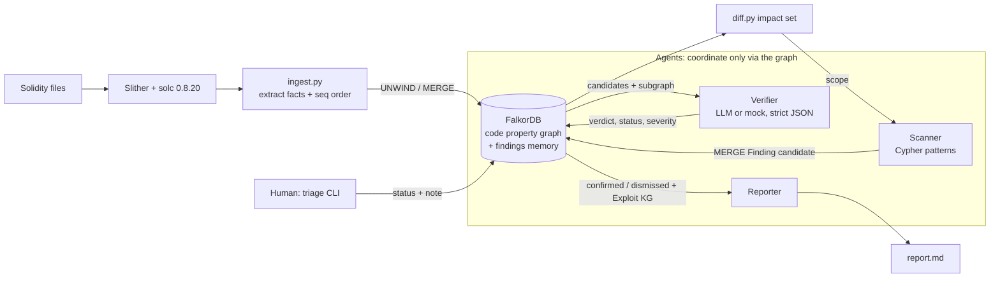
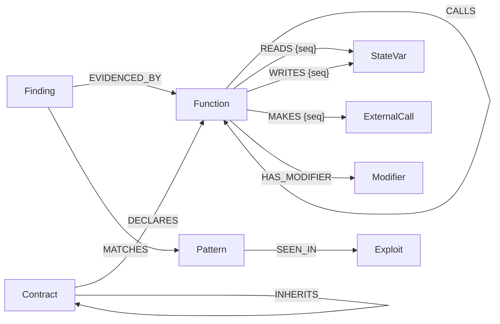

# AuditGraph

**A smart contract audit agent whose detection, evidence and memory all live in a FalkorDB code property graph.**

AuditGraph compiles Solidity into a graph of functions, state variables, modifiers and external calls, with execution order stored on the edges. Vulnerabilities are found by Cypher graph queries, and every finding carries the exact query and graph path that proves it. Three agents (Scanner, Verifier, Reporter) coordinate only through shared graph state. Verdicts and human triage decisions persist across sessions. When a contract is upgraded, AuditGraph diffs it in the graph and re-checks only the changed functions and their callers.

**Tracks entered:** (1) Agents That Act on Connected Data (primary), (2) Agent Memory and Coordination.

---

## Why the graph is essential (what breaks without FalkorDB)

Remove FalkorDB and nothing works, because the graph does the reasoning, not just the storage:

| Capability | Done by | Without the graph |
|---|---|---|
| Reentrancy ("call happens before write") | Cypher comparison of `seq` on two edges of the same function node | no ordering information exists anywhere else |
| Indirect missing access control | Variable-length traversal `CALLS*1..6` with a `none(... guarded)` predicate over every node on the path | would need a hand-written graph search |
| Re-audit impact set | Cypher: changed functions + one-hop `CALLS` callers | no notion of who depends on what |
| Agent coordination | Agents read and write `Finding` nodes; they never call each other | agents cannot hand off work |
| Persistent memory | `MERGE … ON CREATE SET` keeps confirmed/dismissed status forever; `prev_hash` / `audited_hash` on `Function` | every run starts from scratch, and dismissed noise comes back |
| Prioritisation | `algo.pageRank` over `CALLS` | no ranking |
| Historical context | `(Finding)-[:MATCHES]->(Pattern)-[:SEEN_IN]->(Exploit)` | no link to real incidents |

This is proven by a test (`tests/test_memory_and_agents.py::test_graph_is_load_bearing`). It edits **one edge property in FalkorDB** (`WRITES.seq`), and the reentrancy finding disappears. It deletes **one `CALLS` edge**, and the access-control path finding disappears. No Python data structure is involved in detection.

---

## Architecture



---

## Setup

Requirements: Python 3.11+, Docker (or the no-Docker fallback below).

```bash
git clone <this repo> && cd auditgraph
python -m venv .venv && source .venv/bin/activate
pip install -r requirements.txt

# Solidity compiler used by Slither
solc-select install 0.8.20 && solc-select use 0.8.20

# FalkorDB (graph DB + Browser UI on http://localhost:3000)
docker compose up -d
#   No Docker? Real FalkorDB server from pip:
#   pip install falkordblite && ./scripts/falkordb_nodocker.sh

cp .env.example .env    # then export the variables, or set them in your shell
```

Environment variables (see `.env.example`):

| Var | Default | Purpose |
|---|---|---|
| `FALKORDB_HOST` / `FALKORDB_PORT` | `localhost` / `6379` | graph server |
| `AUDITGRAPH_GRAPH` | `auditgraph` | graph name |
| `ANTHROPIC_API_KEY` | (none) | only for the LLM Verifier |
| `LLM_MODEL` | (none) | Anthropic model id for the Verifier; never hardcoded |

### Run

```bash
python -m src.main reset
python -m src.main ingest contracts/VulnBank.sol --version v1
python -m src.main ingest contracts/Wallet.sol
python -m src.main ingest contracts/UncheckedSend.sol
python -m src.main ingest contracts/SafeBank.sol
python -m src.main audit --no-llm          # or: audit  (uses ANTHROPIC_API_KEY + LLM_MODEL)
python -m src.main triage AG-8d7038 dismissed --note "trusted immutable treasury"
python -m src.main ingest contracts/VulnBank_v2.sol --version v2
python -m src.main audit --no-llm          # only the impact set is re-checked
python -m src.main report -o report.md
python -m pytest -q                        # 10 tests, needs FalkorDB running
```

Other commands: `findings` (list graph state), `diff` (show the impact set), `audit --full` (ignore the impact set).

Clear errors are shown when FalkorDB is unreachable, `solc` is missing, Slither fails to compile, or the API key or model is missing.

---

## Graph data model



| Node | Properties | Notes |
|---|---|---|
| `Contract` | id, name, version | |
| `Function` | id, name, visibility, guarded, body_hash, prev_hash, version | extras: `contract`, `source` (for the Verifier), `audited_hash` (memory: hash at last audit), `removed_in` |
| `StateVar` | id, name, privileged | |
| `Modifier` | id, name, is_auth, is_reentrancy_guard | |
| `ExternalCall` | id, kind (`high_level`/`low_level`), checked | extras: `method` (call/send/transfer/function sig), `line` |
| `Finding` | id, pattern, status (`candidate`/`confirmed`/`dismissed`), verdict, reasoning, query, severity, created_at, triage_note | extras: `evidence` (JSON path), `anchor`, `risk`, `resolved_in`, `triaged_by`, `verified_by` |
| `Pattern` | id, name, swc_id | |
| `Exploit` | id, name, year, description | |

| Relationship | Properties | Meaning |
|---|---|---|
| `DECLARES`, `INHERITS`, `CALLS`, `HAS_MODIFIER` | | structure |
| `READS`, `WRITES`, `MAKES` | `seq` | the statement's position inside the function |
| `EVIDENCED_BY`, `MATCHES`, `SEEN_IN` | | findings ↔ code ↔ knowledge |

**Key design decision: `seq` on edges.** Each statement in a function gets an index (statements ranked by source offset). The index is stored on the `READS`/`WRITES`/`MAKES` edge, not on a node, because the same state variable is read and written at different points. With order on the edge, "external call before state write" becomes one Cypher comparison: `m.seq < w.seq`.

Ids: functions use Slither's canonical name (`VulnBank.withdraw(uint256)`), which is stable across versions, so upgrades update the same node. Finding ids are `AG-` plus a hash of `pattern:function`, so the same bug always maps to the same node.

---

## Cypher queries and algorithms

All live in [`src/queries.py`](src/queries.py) and [`src/diff.py`](src/diff.py). `$scope` is null (whole graph) or the impact set.

**1. Reentrancy (SWC-107).** It's a graph problem because order is a property of edges, and the check compares two edges of one node.
```cypher
MATCH (f:Function)-[m:MAKES]->(e:ExternalCall), (f)-[w:WRITES]->(s:StateVar)
WHERE f.visibility IN ['public', 'external']
  AND m.seq < w.seq
  AND NOT e.method IN ['send', 'transfer']
  AND NOT (f)-[:HAS_MODIFIER]->(:Modifier {is_reentrancy_guard: true})
  AND ($scope IS NULL OR f.id IN $scope)
RETURN f.id AS fn, [f.id] AS path,
       collect(DISTINCT {call: e.method, call_seq: m.seq, line: e.line, write: s.name, write_seq: w.seq}) AS evidence
```

**2. Missing access control, direct (SWC-105/106).** It's a graph problem because it's a 1-hop neighbourhood check joining function, guard and privilege.
```cypher
MATCH (f:Function)-[w:WRITES]->(s:StateVar {privileged: true})
WHERE f.visibility IN ['public', 'external'] AND NOT f.guarded
  AND ($scope IS NULL OR f.id IN $scope)
RETURN f.id AS fn, [f.id] AS path, collect(DISTINCT {write: s.name, write_seq: w.seq}) AS evidence
```

**3. Missing access control, via call path.** It's a graph problem because it's reachability over an arbitrary-depth call chain, with a predicate that must hold on every node.
```cypher
MATCH p = (entry:Function)-[:CALLS*1..6]->(writer:Function),
      (writer)-[w:WRITES]->(s:StateVar {privileged: true})
WHERE entry.visibility IN ['public', 'external']
  AND none(n IN nodes(p) WHERE n.guarded)
  AND ($scope IS NULL OR any(n IN nodes(p) WHERE n.id IN $scope))
WITH entry, writer, s, w, p ORDER BY length(p)
WITH entry, writer, s, w, collect(p)[0] AS shortest
RETURN entry.id + '->' + writer.id AS fn, [n IN nodes(shortest) | n.id] AS path,
       [{write: s.name, write_seq: w.seq, via: [n IN nodes(shortest) | n.name]}] AS evidence
```

**4. Unchecked low-level call (SWC-104).** It's a graph problem because it's a property filter on the function's outgoing call-site edges.
```cypher
MATCH (f:Function)-[m:MAKES]->(e:ExternalCall {kind: 'low_level', checked: false})
WHERE ($scope IS NULL OR f.id IN $scope)
RETURN f.id AS fn, [f.id] AS path, collect(DISTINCT {call: e.method, call_seq: m.seq, line: e.line}) AS evidence
```

**5. Risk ranking (PageRank).** It's a graph problem because centrality in the call graph shows which shared internals the most paths flow into. The Verifier processes candidates in this order.
```cypher
CALL algo.pageRank('Function', 'CALLS') YIELD node, score
RETURN node.id AS fn, score ORDER BY score DESC
```
A degree-centrality fallback in plain Cypher is used if `algo.*` is unavailable.

**6. Re-audit impact set (memory).** It's a graph problem because "who is affected by a change" is the reverse `CALLS` neighbourhood.
```cypher
MATCH (f:Function)
WHERE f.removed_in IS NULL AND (f.audited_hash IS NULL OR f.audited_hash <> f.body_hash)
OPTIONAL MATCH (caller:Function)-[:CALLS]->(f)
WITH collect(DISTINCT f.id) + collect(DISTINCT caller.id) AS ids
UNWIND ids AS id RETURN DISTINCT id
```

**7. Finding memory (Scanner write).** `MERGE (fd:Finding {id:$id}) ON CREATE SET fd.status = 'candidate', …`. The status is only set on creation, so `confirmed` and `dismissed` are never reset by a re-scan.

**Verified against FalkorDB (module 4.18.3):** `none()`/`any()` over `nodes(p)`, variable-length paths, `algo.pageRank(label, relType)`, `MERGE … ON CREATE/ON MATCH SET`, and pattern predicates all work. `EXISTS { MATCH … }` subqueries are **not** supported, so a pattern predicate (`NOT (f)-[:HAS_MODIFIER]->(...)`) is used instead.

---

## Agent flow and graph-mediated coordination

1. **Scanner** runs every pattern query (scoped to the impact set) and `MERGE`s a `Finding` per match. Each Finding links to its `Pattern` (`MATCHES`) and to every function on the evidence path (`EVIDENCED_BY`), and stores the exact query text. Findings in scope that no longer match get `resolved_in = <version>`.
2. **Verifier** selects `Finding {status:'candidate'}` ordered by PageRank risk. For each one it pulls the surrounding subgraph from FalkorDB: evidence functions, source, modifiers, callers, and seq-ordered READS/WRITES/MAKES. It asks the LLM for strict JSON `{verdict, status, reasoning, severity}`, then validates it: keys, enum values and severity. Malformed output is retried with the validation error. If it still fails, the finding stays `candidate` with `verifier_error` set, and unparsed text is never written. `--no-llm` gives deterministic verdicts built from the graph evidence.
3. **Human triage** (`triage <id> <status> --note`) writes `status`, `triage_note` and `triaged_by='human'` onto the Finding.
4. **Reporter** reads only graph state: confirmed findings plus their `Pattern -> Exploit` history, then dismissed and resolved findings.

No agent imports or calls another. Each one could run in a separate process or session, because the graph is the message bus and the memory.

---

## Demo walkthrough (real output)

```text
$ python -m src.main audit --no-llm          # after ingesting the 4 v1 contracts
Scanner  matched=7 new=7 resolved=0
Verifier mock: {'verified': 7, 'errors': 0}
│ AG-29ab22 │ confirmed │ Critical │ missing_access_control_direct:Wallet.setOwner(address)
│ AG-2f748b │ confirmed │ Critical │ missing_access_control_path:Wallet.initialize()->Wallet._setAdmin(address)
│ AG-8d7038 │ confirmed │ High     │ reentrancy:VulnBank.sweepFees()
│ AG-656659 │ confirmed │ High     │ reentrancy:VulnBank.withdraw(uint256)
│ AG-c4d4fc │ confirmed │ High     │ reentrancy:VulnBank.withdrawAll()
│ AG-cd0960 │ confirmed │ Medium   │ unchecked_low_level_call:UncheckedSend.payout(address,uint256)
│ AG-63c9fa │ confirmed │ Medium   │ unchecked_low_level_call:UncheckedSend.withdraw()
                                              (SafeBank: zero findings)
$ python -m src.main triage AG-8d7038 dismissed --note "trusted immutable treasury"
$ python -m src.main ingest contracts/VulnBank_v2.sol --version v2
│ VulnBank │ VulnBank.sweepFees()               │ changed │
│ VulnBank │ VulnBank.transfer(address,uint256) │ new     │
│ VulnBank │ VulnBank.withdraw(uint256)         │ changed │
$ python -m src.main audit --no-llm
Scope: 4 functions (impact set)
  VulnBank.rebalance(), VulnBank.sweepFees(), VulnBank.transfer(address,uint256), VulnBank.withdraw(uint256)
Scanner  matched=1 new=0 resolved=1         # withdraw fixed; sweepFees re-matched but STAYS dismissed
Verifier mock: {'verified': 0, 'errors': 0}
```

`rebalance()` is re-checked because it **calls** the changed `sweepFees()`. `deposit`, `withdrawAll` and `getBalance` are not re-checked, and `withdrawAll` keeps its confirmed verdict from memory. See [`demo/sample_report.md`](demo/sample_report.md) for the generated report and [`demo/script.md`](demo/script.md) for the video script.

---

## Data sources

- `contracts/*.sol`: **synthetic** contracts written for this project (ground truth in `contracts/EXPECTED.md`).
- `src/exploits.py`: short summaries of **public, widely documented** incidents (The DAO, Parity x2, Rubixi, Lendf.Me, Poly Network, King of the Ether). Amounts are approximate and marked `~`.
- SWC ids reference the public SWC Registry.
- No private, login-gated or paywalled data.

## AI assistance and third-party tools disclosure

- **AI assistant:** Claude (Anthropic) was used as a pair programmer to draft code, queries, tests and docs. All code was run against a live FalkorDB instance, and the author reviewed it and can explain it (see [`docs/EXPLAIN.md`](docs/EXPLAIN.md)).
- **FalkorDB**: graph database (primary data store, query engine, algorithms, agent memory).
- **Slither** (Trail of Bits, AGPL-3.0) and **solc / solc-select**: Solidity parsing and SlithIR.
- **Anthropic API** (`anthropic` SDK): the Verifier agent's LLM, model chosen via `LLM_MODEL`.
- **rich** (CLI output), **pytest** (tests), **falkordblite** (optional no-Docker FalkorDB server).

## Limitations and future work

Honest list of where the heuristics are weak:

- **`guarded`**: true if a function has an auth modifier (one whose body compares `msg.sender` with `==`/`!=`), or its own body has a `require`/`if` with an `==`/`!=` comparison on `msg.sender`. It misses role mappings (`require(isAdmin[msg.sender])`), `hasRole(...)` calls, and `tx.origin` checks. It does not check that the comparison is to the right variable.
- **`privileged`**: a state var read inside such a guard, or named like owner/admin/governance/…. Privileged vars that are never used in a guard and have unusual names are missed.
- **`checked`**: the call's success flag must be read by a later IR operation in the same function. This is stricter than Slither's own detector (which treats unpacking the tuple as "use"), but it's not path-sensitive: `if (ok) {}` with an empty body counts as checked.
- **`seq`**: statements are ranked by source offset. That's exact for straight-line code and approximate inside loops and branches. A call in one branch and a write in another can be reported as ordered.
- **Reentrancy** is intra-function. A call inside an internal helper followed by a write in the caller, cross-function reentrancy, and read-only reentrancy are not modelled. Extending the path query over `CALLS` with seq on the `CALLS` edge would fix the first case.
- **Re-audit** is one hop of callers, per spec. Deeper transitive impact is a one-line change (`CALLS*1..k`).
- A re-scan never re-opens a verdict. A confirmed finding whose function changed but still matches keeps its old verdict and reasoning.
- The real LLM path is unit-tested with a fake client. Live calls depend on your key and model.
- Future: Streamlit/Browser views, inheritance-aware entry points, SmartBugs benchmark run, `CALLS*` reentrancy.
